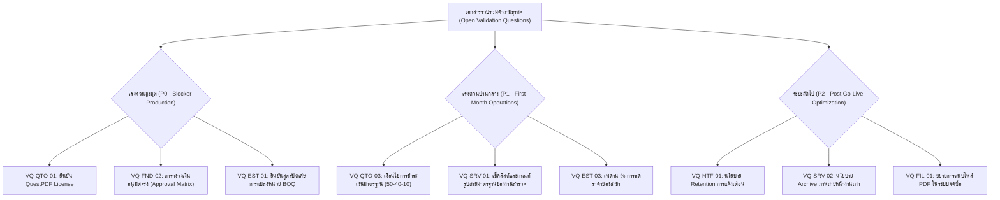

# เอกสารรวบรวมคำถามและสมมติฐานทางธุรกิจ (Open Business Validation Questions)

> **สถานะเอกสาร:** ฉบับร่างสมบูรณ์สำหรับรอการยืนยัน (Pending Stakeholder Sign-Off)  
> **วัตถุประสงค์:** รวบรวมและจัดหมวดหมู่ "สมมติฐานทางธุรกิจชั่วคราว (TEST_ONLY Defaults)" และ "คำถามที่เปิดค้าง (Open Validation Questions)" ของระบบ **tan-erp** ทุกโมดูลไว้ในจุดเดียว เพื่อให้เจ้าของกระบวนการธุรกิจ (Business Owners), ฝ่ายการเงิน (Finance), ทีมกฎหมาย (Legal), และทีมปฏิบัติการ (Operations) ตรวจสอบและอนุมัติเป็นลายลักษณ์อักษรก่อนเปิดใช้งานจริงบน Production

---

## 1. บทนำและแนวทางการให้คำตอบ (Introduction & Guidelines)

ในระหว่างการพัฒนาซอฟต์แวร์ระยะ Application Implementation (Wave A และ Wave B) ทีมพัฒนาได้ยึดหลักการความปลอดภัยสูงสุดแบบ **Fail-Closed** ควบคู่กับการกำหนด **TEST_ONLY Defaults** เพื่อให้ระบบสามารถทดสอบ End-to-End และคงความสมบูรณ์ของข้อมูลได้โดยไม่ต้องเดาข้อมูลทางธุรกิจของลูกค้า

### วิธีการอ่านตารางคำถาม
1. **รหัสคำถาม (Ref ID):** ใช้สำหรับอ้างอิงในการประชุมหรือบันทึกข้อตกลง (ADR)
2. **ประเด็น / ข้อสงสัยทางธุรกิจ:** คำถามที่ต้องการข้อสรุปชัดเจน
3. **สมมติฐานปัจจุบัน (Current Working Assumption / TEST_ONLY):** สิ่งที่ระบบกำลังทำงานอยู่ ณ ปัจจุบัน หากไม่มีการตัดสินใจ ระบบจะยึดพฤติกรรมนี้
4. **ผลกระทบหากไม่สรุป (Impact):** ความเสี่ยงหรือข้อจำกัดต่อการใช้งานจริง
5. **ผู้มีอำนาจตัดสินใจ (Decision Owner):** ผู้มีอำนาจลงนามยืนยัน

---

## 2. หมวดโครงสร้างองค์กร สิทธิ์ และวงเงินอนุมัติ (Foundation, Roles & Approval Limits)

| Ref ID | ประเด็น / ข้อสงสัยทางธุรกิจ | สมมติฐานปัจจุบันในระบบ (TEST_ONLY) | ผลกระทบหากไม่สรุป | ผู้มีอำนาจตัดสินใจ |
| :--- | :--- | :--- | :--- | :--- |
| **VQ-FND-01** | **การรองรับ Multi-Organization ต่อ 1 Deployment:** ในระบบจะมีเพียง 1 องค์กร หรือต้องรองรับหลายนิติบุคคลในฐานข้อมูลเดียวกัน? | มีหลายองค์กรได้ในตาราง แต่ API ปัจจุบันล็อกตาม `OrganizationId` ของผู้เรียก จึงยังไม่มีหน้าจอข้ามองค์กรหรือระบบ Super Admin | หากมีหลายบริษัทในเครือ จะต้องออกแบบสิทธิ์ข้ามองค์กรและระบบ Provisioning เพิ่ม | Business Owner / IT Director |
| **VQ-FND-02** | **ตารางวงเงินอนุมัติตามลำดับขั้น (Approval Limits Matrix):** วงเงินอนุมัติของแต่ละตำแหน่ง (Role) สำหรับ Estimate, PO, Change Order แยกตามสาขาหรือรวมทั้งองค์กร? | **Fail-Closed:** หากไม่มีแถววงเงินในตาราง ระบบจะ **ปฏิเสธการส่งอนุมัติทันที** (ใน Test Env มีเฉพาะบัญชี `Test Admin` ที่ไม่จำกัดวงเงิน) | บน Production ผู้ใช้จะไม่สามารถอนุมัติเอกสารใดๆ ได้เลยจนกว่าจะหยอดตารางวงเงินจริง | Managing Director / CFO |
| **VQ-FND-03** | **เงื่อนไขและนิยามการปิดสาขา (Branch Deactivation):** เงื่อนไขใดที่อนุญาตให้ปิดหรือระงับสาขาได้? | ไม่อนุญาตให้ปิดหากยังมี "เอกสารเปิด" (Estimate ที่ยังไม่ Quoted/Cancelled, PO ค้างรับ, โครงการที่ยังไม่ส่งมอบ ฯลฯ) หรือเป็นสาขาสุดท้าย | อาจบล็อกการปิดสาขาในกรณีต้องการปิดเร่งด่วน หรือเกิดเอกสารค้างในระบบ | Operations / Audit Lead |
| **VQ-FND-04** | **ความเข้มงวดของเลขประจำตัวผู้เสียภาษี (Tax ID):** ต้องบังคับตรวจสอบความถูกต้องแบบ 13 หลัก Mod-11 หรือไม่? | ตรวจสอบรูปแบบ 13 หลักและผ่านสูตร Checksum Mod-11 ของกรมสรรพากรไทย | ลูกค้าชาวต่างชาติหรือองค์กรพิเศษที่ไม่มีเลข 13 หลักจะไม่สามารถบันทึกได้ | Accounting / Tax Lead |

---

## 3. หมวดการสำรวจหน้างาน (Site Survey & Field Mobile)

| Ref ID | ประเด็น / ข้อสงสัยทางธุรกิจ | สมมติฐานปัจจุบันในระบบ (TEST_ONLY) | ผลกระทบหากไม่สรุป | ผู้มีอำนาจตัดสินใจ |
| :--- | :--- | :--- | :--- | :--- |
| **VQ-SRV-01** | **การเลือกเวอร์ชันแม่แบบการสำรวจ (Template Selection):** ช่างหน้างานควรเลือกเวอร์ชันแม่แบบเอง หรือให้ระบบผูกตามประเภทงาน/เวลาเสมอ? | ระบบเลือกแม่แบบเวอร์ชันล่าสุดที่มีผล ณ ปัจจุบัน (`isCurrent`) แบบอัตโนมัติ โดยมีค่ามาตรฐานบังคับภาพถ่ายขั้นต่ำ 1 รูปต่อพื้นที่ และตรวจเช็คลิสต์โครงสร้าง | ช่างไม่สามารถเลือกใช้แม่แบบพิเศษเฉพาะงานได้ เว้นแต่จะระบุใน Template Code ใหม่ | Survey / Service Manager |
| **VQ-SRV-02** | **นโยบายการจัดเก็บและล้างภาพถ่ายหน้างาน (Photo Retention & Purge):** ภาพถ่ายและผลการวัดหน้างานที่ส่งมอบโครงการแล้ว ต้องเก็บไว้นานเท่าใด? | เก็บถาวรใน Storage และบันทึก SHA-256 ลงฐานข้อมูล ไม่มีการลบอัตโนมัติ | ค่าใช้จ่ายพื้นที่จัดเก็บข้อมูล (Cloud Storage) จะเพิ่มขึ้นต่อเนื่องตามจำนวนงาน | Operations / IT Director |
| **VQ-SRV-03** | **การจัดการข้อขัดแย้งขณะทำงานออฟไลน์ (Mobile Offline Conflict Resolution):** หากช่างสองคนบันทึกผลการวัดห้องเดียวกันขณะออฟไลน์ แล้วกลับมาออนไลน์พร้อมกัน จะให้ข้อมูลใดชนะ? | ยึดตามลำดับการส่งเข้า Server ล่าสุด (Last-Write-Wins ต่อ Snapshot Revision) และมี Revision Number ป้องกันการเขียนทับโดยไม่รู้ตัว | ข้อมูลของช่างคนที่ sync ก่อนอาจถูกอัปเดตทับด้วย revision ถัดไป | Lead Engineer / Field Supervisor |

---

## 4. หมวดการประเมินราคา BOQ และ Quick Estimate (Official Estimate & Pricing)

| Ref ID | ประเด็น / ข้อสงสัยทางธุรกิจ | สมมติฐานปัจจุบันในระบบ (TEST_ONLY) | ผลกระทบหากไม่สรุป | ผู้มีอำนาจตัดสินใจ |
| :--- | :--- | :--- | :--- | :--- |
| **VQ-EST-01** | **การเปิดใช้งาน Unit Conversion Snapshot (G-08):** ยืนยันการเปิดใช้ความสามารถแปลงหน่วยในรายการต้นทุน BOQ และเกณฑ์การปัดเศษ? | ต้นทุนรวมแถว = `round(qty × factor × base cost, 2)` ปัดทศนิยม 2 ตำแหน่งครั้งเดียว; ต้นทุนต่อหน่วย = `round(base cost × factor, 4)` | หากฝ่ายบัญชีต้องการสูตรปัดเศษแบบอื่น ตัวเลขต้นทุนสะสมอาจคลาดเคลื่อนระดับสตางค์ | Cost Accounting Owner |
| **VQ-EST-02** | **การอนุญาตให้ใส่รายการพิเศษนอก Item Master (Ad-Hoc / Custom Work Items):** รายการสั่งทำพิเศษที่ไม่มีรหัสใน Catalog ต้องมีเกณฑ์อนุมัติเฉพาะหรือไม่? | บันทึกเป็น Custom Item ได้โดยต้องกรอกเหตุผล (`custom_reason`), บันทึกต้นทุนแยก, และผ่านการอนุมัติแบบ Maker-Checker ปกติ | หากไม่มีข้อจำกัด อาจทำให้เกิดการไม่ควบคุมมาตรฐานรหัสสินค้าและต้นทุน | Purchasing & Cost Control Lead |
| **VQ-EST-03** | **เพดานและสิทธิ์การปรับลดราคาหน้างาน (Quick Estimate Branch Override):** ผู้จัดการสาขาสามารถปรับลด/เพิ่มอัตราคิดราคา (Rate Override) ได้สูงสุดกี่เปอร์เซ็นต์? | สาขาขอ override ได้ โดยต้องให้ผู้ถือสิทธิ์ `pricing-templates.approve` อนุมัติ และมีอายุไม่เกิน 366 วัน (ยังไม่มีเพดาน % สูงสุดล็อกในโค้ด) | อาจเกิดการลดราคามากเกินไปจนกระทบกำไรขั้นต้น (Gross Margin) หากไม่มีเพดานล็อก | Sales Director / CFO |
| **VQ-EST-04** | **รายการกลุ่มงาน (Work Types) สำหรับ Quick Estimate ใน Release แรก:** ปรเภทงานใดบ้างที่จะเปิดให้ประเมินด่วนผ่านหน้าร้าน? | อนุมัติเบื้องต้น 3 กลุ่ม: งานเฟอร์นิเจอร์บิวท์อิน (Built-in), ผ้าม่าน (Curtain), และวอลเปเปอร์ (Wallpaper) | หากมีกลุ่มงานโครงสร้างหรือต่อเติม จะต้องสร้างสูตรคำนวณและ Template ใหม่ | Commercial Director |

---

## 5. หมวดใบเสนอราคา การยอมรับของลูกค้า และลิขสิทธิ์ PDF (Commercial Quotation & Legal)

| Ref ID | ประเด็น / ข้อสงสัยทางธุรกิจ | สมมติฐานปัจจุบันในระบบ (TEST_ONLY) | ผลกระทบหากไม่สรุป | ผู้มีอำนาจตัดสินใจ |
| :--- | :--- | :--- | :--- | :--- |
| **VQ-QTO-01** | **การยืนยันเงื่อนไขลิขสิทธิ์ QuestPDF (QuestPDF License Confirmation):** บริษัทผ่านเกณฑ์รายได้สำหรับ Community License (< $1M USD) หรือต้องจัดซื้อ Commercial License? | ระบบเปิดใช้งานด้วย `LicenseType: Community` และบันทึก Warning ใน Log หากรันบน Production โดยไม่มีการยืนยัน `Documents:QuestPdf:LicenseConfirmed=true` | ความเสี่ยงด้านการละเมิดสิทธิ์ทรัพย์สินทางปัญญาของไลบรารีซอฟต์แวร์ | Legal Counsel / IT Director |
| **VQ-QTO-02** | **ผลผูกพันทางกฎหมายของภาพลายเซ็น (Digital Signature vs Electronic Signature):** การบันทึกภาพลายเซ็นคู่กับ IP, วันเวลา และ SHA-256 ผ่านลิงก์ยอมรับใบเสนอราคา ถือว่ามีผลผูกพันตามกฎหมายเพียงพอหรือไม่? | เก็บภาพลายเซ็น (PNG) + วันเวลาเซิร์ฟเวอร์ + SHA-256 + Audit Log แต่ **ไม่ใช่ e-Signature ขั้นสูง (Advanced/Qualified) ที่มี Certificate PKI** | ในกรณีมีข้อพิพาททางคดีความ อาจต้องใช้พยานหลักฐานอื่นประกอบสัญญาจ้าง | Legal / Corporate Compliance |
| **VQ-QTO-03** | **เงื่อนไขการชำระเงินและข้อความท้ายใบเสนอราคา (Commercial Terms & Payment Terms):** งวดการชำระเงินและเงื่อนไขการยืนราคามาตรฐานขององค์กร? | งวดเงิน 3 งวด: มัดจำ 50%, ส่งวัสดุเข้าหน้างาน 40%, ส่งมอบงาน 10%; ยืนราคาภายใน 30 วันนับจากวันที่ออกเอกสาร | หากเงื่อนไขจริงของบริษัทต่างจากนี้ ต้องแจ้งเพื่อปรับ Document Template มาตรฐาน | Finance Director / Sales Lead |
| **VQ-QTO-04** | **นโยบายต่อใบเสนอราคาที่ออกก่อนติดตั้งระบบ PDF (Legacy Quotations):** เอกสารใบเสนอราคาเดิมที่ไม่มีไฟล์ PDF ในระบบ จะใช้วิธีใดเมื่อลูกค้าขอไฟล์? | ระบบ **ไม่ออก PDF ย้อนหลังให้เอกสารเก่า** โดยอัตโนมัติ (คืน 404 หากดาวน์โหลด); ผู้ใช้ต้องกด "Amend (ออกฉบับใหม่)" หรือใช้ Browser Print เดิม | พนักงานขายอาจสับสนหากพยายามดาวน์โหลดไฟล์ของเอกสารฉบับเก่า | Sales Admin / Operations |

---

## 6. หมวดระบบแจ้งเตือนและประวัติการตรวจสอบ (Notifications & Auditing)

| Ref ID | ประเด็น / ข้อสงสัยทางธุรกิจ | สมมติฐานปัจจุบันในระบบ (TEST_ONLY) | ผลกระทบหากไม่สรุป | ผู้มีอำนาจตัดสินใจ |
| :--- | :--- | :--- | :--- | :--- |
| **VQ-NTF-01** | **อายุการจัดเก็บรายการแจ้งเตือน (Notification Retention Period):** การแจ้งเตือนในกระดิ่งแจ้งเตือนที่ผู้ใช้อ่านแล้ว ควรเก็บไว้กี่วันก่อนลบออกจากระบบ? | ปัจจุบัน **ไม่มีการลบข้อมูลออกจากตาราง** (No Purge / Retention Policy) ข้อมูลจะสะสมไปเรื่อยๆ | ตารางการแจ้งเตือนอาจมีขนาดใหญ่ขึ้นมากในระยะยาว ส่งผลต่อประสิทธิภาพการสืบค้น | IT Operations / DBA |
| **VQ-NTF-02** | **ลำดับการแจ้งเตือนการอนุมัติแบบหลายขั้น (Multi-level Approval Routing):** เมื่อผู้ตรวจขั้นที่ 1 อนุมัติแล้ว ควรแจ้งเตือนไปยังผู้ตรวจขั้นที่ 2 อัตโนมัติทันทีหรือไม่? | แจ้งเตือนเฉพาะผู้มีสิทธิ์ขั้นแรกของ Route; การแจ้งเตือนขั้นถัดไปยังพึ่งพาการเปิดดู Review Queue | ผู้ตรวจขั้นสูงอาจไม่ทราบว่ามีเอกสารรอการอนุมัติต่อจากขั้นแรก | Business Process Owner |

---

## 7. หมวดไฟล์แนบและภาพถ่ายร่วม (Shared File Attachments)

| Ref ID | ประเด็น / ข้อสงสัยทางธุรกิจ | สมมติฐานปัจจุบันในระบบ (TEST_ONLY) | ผลกระทบหากไม่สรุป | ผู้มีอำนาจตัดสินใจ |
| :--- | :--- | :--- | :--- | :--- |
| **VQ-FIL-01** | **ขอบเขตประเภทไฟล์แนบของระบบกลาง (Allowed File Types):** อนุญาตเฉพาะไฟล์รูปภาพ (JPEG, PNG, WEBP) หรือรวมถึงไฟล์เอกสาร (PDF, CAD, ZIP)? | ปัจจุบันระบบกลางรองรับเฉพาะรูปภาพ (สำหรับหน้างาน, สินค้า, ลายเซ็น); โมดูล Procurement ที่ต้องการแนบใบเสนอราคาคู่แข่งเป็น PDF ยังรอเปิดขอบเขต | ไม่สามารถแนบไฟล์สเปกเครื่องจักรหรือเอกสารสัญญาเพิ่มเติมในรูปแบบ PDF ได้ | Operations / IT Director |
| **VQ-FIL-02** | **ขนาดไฟล์สูงสุดต่อการอัปโหลด (Max Upload Size):** กำหนดขนาดไฟล์รูปภาพสูงสุดกี่ Megabytes ต่อรูป? | จำกัดขนาดที่ 15 MB ต่อไฟล์รูปภาพ และทำการตรวจสอบ Magic Bytes ที่เซิร์ฟเวอร์ | หากขนาดใหญ่เกินไปอาจเปลืองแบนด์วิดท์มือถือหน้างาน; หากเล็กไปรูปอาจขาดความคมชัด | IT Infrastructure / Mobile Lead |

---

## 8. หมวดควบคุมโครงการ โครงสร้าง WBS และเวลาทำงาน (Project WBS, Cost Ledger & Labor Timesheet — Wave C)

| Ref ID | ประเด็น / ข้อสงสัยทางธุรกิจ | สมมติฐานปัจจุบันในระบบ (TEST_ONLY) | ผลกระทบหากไม่สรุป | ผู้มีอำนาจตัดสินใจ |
| :--- | :--- | :--- | :--- | :--- |
| **VQ-PRJ-01** | **ความลึกสูงสุดของโครงสร้างงานโครงการ (WBS Max Depth):** โครงสร้าง WBS ต้องการความลึกกี่ระดับ และต้องใช้รหัสมาตรฐานกลางของบริษัทหรือไม่? | รองรับลำดับชั้นลึกสุด **3 ระดับ** (`Level 1–3`) โดยรหัส WBS ไม่ซ้ำกันภายในโครงการเดียวกัน และผูกบรรทัดงบประมาณเข้ากับ WBS Node ได้ | หากโครงการขนาดใหญ่ต้องการแยกย่อยเกิน 3 ระดับ จะต้องปรับเพดาน `MaxWbsDepth` ใน Domain | Project Management Director |
| **VQ-PRJ-02** | **แหล่งที่มาของอัตราค่าแรงต่อชั่วโมง (Labor Rate Source & Fallback):** อัตราค่าแรงของช่าง/พนักงานควรผูกตามตำแหน่ง (Role) หรือรายบุคคล และใช้อัตราใดเมื่อยังไม่ตั้งค่า? | ตั้งค่าอัตราค่าแรงต่อชั่วโมงแยกตามรายบุคคลในโครงการ (`LaborRate`) หากยังไม่กำหนดจะใช้ค่าเริ่มต้น `TEST_ONLY` ที่ **150 บาท/ชั่วโมง** | ต้นทุนค่าแรงที่โพสต์เข้าโครงการอาจไม่ตรงกับอัตราเงินเดือนจริงหากไม่กำหนดอัตราจริงก่อนอนุมัติ Timesheet | HR / Production / Finance Lead |
| **VQ-PRJ-03** | **เกณฑ์ชั่วโมงทำงานล่วงเวลาและเพดานต่อวัน (Timesheet Overtime & Daily Cap):** เกณฑ์แจ้งเตือน OT และเพดานชั่วโมงทำงานสูงสุดต่อคนต่อวันควรเป็นเท่าใด และคิดอัตราคูณ OT (1.5x / 3x) หรือไม่? | จำกัดชั่วโมงสะสมต่อคนต่อวันไม่เกิน **24 ชั่วโมง** และติดป้ายแจ้งเตือน (`isOvertimeWarning`) เมื่อเกิน **8 ชั่วโมง/วัน** โดยคิดอัตราค่าแรงคงที่ตาม `hourlyRate` | หากต้องการแยกอัตราค่าแรงปกติกับค่าล่วงเวลาหลายอัตรา จะต้องเพิ่มฟิลด์ประเภทชั่วโมงและตัวคูณใน Timesheet | Production Manager / HR |
| **VQ-PRJ-04** | **นโยบายเมื่อต้นทุนจริงและภาระผูกพันเกินงบประมาณ (Budget Overrun Policy):** เมื่อยอด `Committed + Actual` เกินงบปัจจุบัน ระบบควรบล็อกการเบิกของ/อนุมัติเวลาทำงาน หรือแจ้งเตือนให้ทำ Change Order? | บันทึกเข้า `ProjectCostLedgerEntry` ตามข้อเท็จจริงหน้างาน (ไม่บล็อกการเบิกจ่ายวัสดุหรืออนุมัติเวลาทำงาน) พร้อมส่งการแจ้งเตือน `project.budget-overrun` ให้ผู้มีสิทธิ์อนุมัติ Change Order ทันที | หากต้องการล็อกห้ามเบิกวัสดุเกินงบโดยเด็ดขาด จะต้องเปลี่ยนจาก Soft Alert เป็น Hard Gate | CFO / Project Director |

---

## 9. หมวดจัดซื้อครบวงจร การคืนสินค้า และ 3-Way Match ใบแจ้งหนี้ผู้ขาย (Procurement Completion — Wave C `G-11`)

| Ref ID | ประเด็น / ข้อสงสัยทางธุรกิจ | สมมติฐานปัจจุบันในระบบ (TEST_ONLY) | ผลกระทบหากไม่สรุป | ผู้มีอำนาจตัดสินใจ |
| :--- | :--- | :--- | :--- | :--- |
| **VQ-PRC-01** | **กฎการรวมใบขอซื้อ (PR Consolidation) และวงเงินอนุมัติ PR:** ใบขอซื้อต้องใช้วงเงินอนุมัติชุดเดียวกับ PO หรือแยกตารางวงเงินเฉพาะ PR และอนุญาตให้รวม PR ข้ามโครงการใน PO ใบเดียวกันหรือไม่? | ใช้เกณฑ์ Maker ≠ Checker ร่วมกับตารางวงเงินอนุมัติ `purchase-order` (`G-03`) และอนุญาตให้รวมหลาย PR ที่ `approved` ในสาขาเดียวกันและโครงการเดียวกัน (หรือไม่ผูกโครงการ) เข้าเป็น PO ร่างใบเดียวได้ครั้งเดียว | หากฝ่ายจัดซื้อต้องการรวมซื้อวัสดุจากหลายโครงการใน PO ใบเดียว จะต้องเปลี่ยน ProjectId จากระดับหัวเอกสาร PO ไปเป็นระดับบรรทัด | Procurement Manager / CFO |
| **VQ-PRC-02** | **นโยบายการคืนสินค้าให้ผู้ขาย (Supplier Return) เมื่อรับเข้าคลังแล้ว:** เมื่อบันทึกคืนสินค้าจากใบรับ (`GR`) ที่รับเข้าคลังแล้ว ควรตัดสต็อกอัตโนมัติและเปิดยอดค้างรับใน PO เดิมเพื่อรอรับของเปลี่ยน หรือปิดยอดสั่งซื้อเลย? | ระบบตัดสต็อกอัตโนมัติ (`return_out`) ผ่าน `IProcurementStockPort` ใน Transaction เดียวกัน ลด `receivedQuantity` บนบรรทัด PO เพื่อเปิดยอดค้างรับสำหรับของทดแทน และคืนยอด Commitment ของโครงการ (`+returnValue`) โดยห้ามคืนส่วนที่วางบิลแล้ว | หากผู้ขายคืนเป็นใบลดหนี้ (Credit Note) แทนการส่งของเปลี่ยน จะต้องเพิ่มตัวเลือกปิดยอดค้างรับโดยไม่รอรับของใหม่ | Procurement / Warehouse Lead |
| **VQ-PRC-03** | **เกณฑ์ความคลาดเคลื่อนของ 3-Way Match (Quantity & Price Variance Tolerance):** ยอมรับส่วนต่างปริมาณและราคาต่อหน่วยในใบแจ้งหนี้ผู้ขายเทียบกับ PO/GR ได้กี่เปอร์เซ็นต์ก่อนพักเอกสาร (`on_hold`)? | ปริมาณวางบิลห้ามเกินยอดรับสุทธิ (`0%` qty tolerance → เกินคืน `422 SUPPLIER_INVOICE_OVER_RECEIVED`); ราคาต่อหน่วยต่างจาก PO ไม่เกิน **`2%`** (`<= 0.02`) ผ่านเป็น `matched` ทันที หากเกิน `2%` จะพักเป็น `on_hold` เพื่อรอผู้มีสิทธิ์อนุมัติปลด Hold และบันทึกเฉพาะ **ผลต่างราคา (Price Variance)** เข้า `ProjectCostLedgerEntries` | หากธุรกิจต้องการยอมรับส่วนต่างราคาเป็นจำนวนเงินบาทคงที่ควบคู่กับ `%` หรือไม่ยอมรับส่วนต่างเลย (`0%`) ต้องปรับค่าคงที่ใน Domain | CFO / Accounting Manager |

---

## 10. หมวดคลังสินค้า ตำแหน่งจัดเก็บ Lot/Serial และการปิดงวด (Inventory Completion — Wave C `G-12`)

| Ref ID | ประเด็น / ข้อสงสัยทางธุรกิจ | สมมติฐานปัจจุบันในระบบ (TEST_ONLY) | ผลกระทบหากไม่สรุป | ผู้มีอำนาจตัดสินใจ |
| :--- | :--- | :--- | :--- | :--- |
| **VQ-INV-01** | **ระดับการคำนวณต้นทุนเฉลี่ย (Moving Average Valuation Scope — Warehouse vs Lot):** ต้นทุนเฉลี่ยเคลื่อนที่ควรคำนวณรวมที่ระดับ `(Warehouse, Item)` หรือแยกต้นทุนตามแต่ละ Lot? | คำนวณต้นทุนเฉลี่ยเคลื่อนที่และการจองที่ระดับ `(Warehouse, Item)` ในขณะที่ควบคุมปริมาณคงเหลือ (`OnHand >= 0`) แยกราย `(Warehouse, Location, Item, Lot)` | หากฝ่ายบัญชีต้องการตีมูลค่าแบบ FIFO หรือแยกต้นทุนต่อ Lot จะต้องเพิ่มคอลัมน์มูลค่าใน `stock_location_balances` | CFO / Warehouse Manager |
| **VQ-INV-02** | **ต้นทุนการรับคืนวัสดุจากโครงการ (Project Return Valuation):** เมื่อรับวัสดุเหลือใช้จากหน้างานกลับเข้าคลัง ควรใช้ต้นทุนตอนเบิกออกล่าสุดหรือต้นทุนเฉลี่ยปัจจุบันของคลัง? | ใช้ต้นทุนต่อหน่วยจากใบเบิกโครงการที่อ้างอิง (หรือใบเบิกล่าสุดของโครงการนั้น) เพื่อกลับรายการ Actual Cost ใน `ProjectCostLedgerEntries` (`stock_return`, `isReversal: true`) ได้ตรงตามมูลค่าที่เคยเบิก | หากวัสดุที่คืนมีสภาพเสื่อมราคาและต้องการรับคืนในมูลค่าต่ำกว่าตอนเบิก ผู้ใช้ต้องระบุ `unitCost` เองตอนทำรายการคืน | Cost Accountant / Project Director |
| **VQ-INV-03** | **นโยบายการเปิดงวดสต็อกที่ปิดไปแล้ว (Reopening Closed Inventory Period):** หลังจากปิดงวดสต็อกรายเดือนแล้ว หากพบรายการตกหล่น อนุญาตให้ผู้ดูแลเปิดงวดเดิมชั่วคราวหรือต้องปรับปรุงในงวดปัจจุบันเท่านั้น? | งวดที่ปิดแล้ว (`inventory.period_closes`) ถูกล็อกถาวร (`409 INVENTORY_PERIOD_CLOSED` สำหรับรายการที่มี `occurredAtUtc <= periodEndDate`) หากต้องแก้ไขต้องทำรายการปรับปรุง (`Adjustment`) ในงวดปัจจุบันที่เปิดอยู่ | หากฝ่ายบัญชีต้องการสิทธิ์ Reopen งวดเดือนก่อนหน้าแบบมี Audit จะต้องเพิ่มสถานะและสิทธิ์เฉพาะระดับ CFO | CFO / Internal Audit |

---

## 11. หมวดการผลิต สถานีงาน กำลังการผลิต และการจ้างผลิตภายนอก (Production Completion — Wave C `G-13`)

| Ref ID | ประเด็น / ข้อสงสัยทางธุรกิจ | สมมติฐานปัจจุบันในระบบ (TEST_ONLY) | ผลกระทบหากไม่สรุป | ผู้มีอำนาจตัดสินใจ |
| :--- | :--- | :--- | :--- | :--- |
| **VQ-PROD-01** | **ความจุมาตรฐานต่อวันของสถานีงาน (Standard Work Center Daily Capacity):** ความจุปกติของแต่ละ Work Center คิดจากกะเดียว 8 ชม./วัน หรือต้องรองรับหลายกะแยกตามวันในสัปดาห์? | ใช้ค่าเริ่มต้น `DailyCapacityHours = 8.00` ชม./วัน (ปรับแก้ได้ต่อ Work Center ในช่วง `0.25 .. 24.00` ชม./วัน) และกระจายภาระงานตามช่วง `[PlannedStartDate, PlannedEndDate]` แบบเส้นตรง | หากโรงงานเปิดโอทีหรือกะดึกเฉพาะบางวัน จะต้องปรับ `DailyCapacityHours` หรือเชื่อมกับตารางกะการทำงาน | Production Manager |
| **VQ-PROD-02** | **การคำนวณต้นทุนเข้าสินค้าสำเร็จรูป (FG Absorption of Labor & Subcontract Cost):** เมื่อรับผลผลิตเข้าคลัง ควรรวมต้นทุนแรงงานจากใบลงเวลา (`G-20`) และค่าจ้างผลิตภายนอก (`G-11`) เข้ามูลค่าสินค้าสำเร็จรูปโดยตรง หรือคิดค่าโสหุ้ยโรงงาน (Factory Overhead %) เพิ่มเติม? | รวม `NetIssuedMaterialValue + LaborCost + SubcontractCost` เป็น `TotalManufacturingCost` และตัดเข้ามูลค่าสต็อกสินค้าสำเร็จรูปตามสัดส่วนจำนวนที่รับเข้าคลังโดยยังไม่มีอัตราโสหุ้ยคงที่ | หากฝ่ายบัญชีต้นทุนต้องการคิด Overhead Absorption ตามชั่วโมงเครื่องจักร (`WorkCenter.HourlyRate`) จะต้องเปิดสูตรคำนวณโสหุ้ยเพิ่มตอนรับผลผลิต | CFO / Cost Accountant |
| **VQ-PROD-03** | **การบังคับลำดับขั้นตอนการผลิตก่อนรับผลผลิต (Mandatory Operation Completion Gate):** ต้องบังคับให้กด Complete ทุก Operation ใน Routing ก่อนจึงจะรับสินค้าสำเร็จรูปเข้าคลังได้หรือไม่? | ไม่บล็อกการรับผลผลิตบางส่วนหากขั้นตอนภายในยังเป็น `pending` เพื่อความคล่องตัวหน้างาน แต่บันทึก Snapshot ชั่วโมงตามแผนและชั่วโมงจริงไว้ตรวจสอบย้อนหลัง | หากต้องการบังคับ Shop-floor Control เข้มงวด ต้องเปิด Gate บังคับให้ทุก Operation เป็น `completed` ก่อนรับผลผลิตงวดสุดท้าย | Production Manager |

---

## 12. หมวดการวางแผนความต้องการวัสดุ พารามิเตอร์สต็อกปลอดภัย และปฏิทินวันทำงาน (MRP Completion — Wave C `G-14`)

| Ref ID | ประเด็น / ข้อสงสัยทางธุรกิจ | สมมติฐานปัจจุบันในระบบ (TEST_ONLY) | ผลกระทบหากไม่สรุป | ผู้มีอำนาจตัดสินใจ |
| :--- | :--- | :--- | :--- | :--- |
| **VQ-MRP-01** | **ระดับการตั้งค่าพารามิเตอร์วางแผน (Warehouse-Specific vs Organization Default Planning Parameters):** พารามิเตอร์ `SafetyStock`, `MinOrderQuantity`, `LotMultiple` และ `LeadTimeDays` ควรบังคับแยกทุกคลัง หรือรวมยอดที่ระดับองค์กรเมื่อคำนวณ MRP ทั้งองค์กร? | รองรับทั้งค่าเฉพาะคลัง (`WarehouseId != null`) และค่าเริ่มต้นระดับองค์กร (`WarehouseId == null`); เมื่อคำนวณ MRP (ซึ่งรวมสต็อกทุกคลังที่ Active ขององค์กร) ระบบใช้แถวระดับองค์กรก่อน และหากไม่มีจะใช้แถวแรกของคลังในองค์กรตามลำดับ Deterministic | หากต้องการคำนวณ MRP แยกรายคลังอิสระ (Multi-Warehouse Independent MRP) จะต้องเพิ่มตัวกรอง `WarehouseId` ตอนสั่งรัน MRP | Supply Chain / Production Planner |
| **VQ-MRP-02** | **ปฏิทินวันทำงานและวันหยุดประจำสัปดาห์ (Working Calendar Holidays vs Weekend Policy):** การถอยวันสั่งซื้อ/สั่งผลิต (`OrderBy = NeedBy - LeadTimeDays`) ควรข้ามเฉพาะวันหยุดที่ลงทะเบียนไว้ในปฏิทิน หรือข้ามวันเสาร์-อาทิตย์โดยอัตโนมัติด้วย? | ข้ามเฉพาะวันที่ลงทะเบียนใน `mrp.working_calendar_holidays` (ทั้งตอนถอย `OrderBy` ใน MRP และตอนปรับ `CapacityHours = 0` ใน `G-13` Daily Capacity View) เพื่อให้โรงงานที่เปิดกะวันเสาร์หรืออาทิตย์บริหารวันหยุดเองได้เต็มที่ | หากต้องการให้วันอาทิตย์เป็นวันหยุดอัตโนมัติทุกสัปดาห์โดยไม่ต้องเพิ่มในตาราง ผู้ดูแลสามารถนำเข้าวันอาทิตย์ประจำปีหรือเพิ่มตั้งค่า `WeekendDays` ระดับองค์กร | Production Manager / HR |
| **VQ-MRP-03** | **นโยบายการปัดยอดสั่งซื้อ/สั่งผลิตตาม MOQ และ Lot Multiple (Order Sizing & Excess Carry-Over):** เมื่อปัดยอดสั่งขึ้นตาม `MinOrderQuantity` และ `LotMultiple` แล้ว ยอดส่วนเกินที่สั่งเกินความต้องการของวันนั้นควรนำไปหักความต้องการของวันถัดไปอัตโนมัติหรือไม่? | ปัดยอดเป็น `max(NetShortage, MinOrderQuantity)` แล้วปัดขึ้นเป็นทวีคูณของ `LotMultiple` (`ceil(qty / LotMultiple) * LotMultiple`) และนำส่วนเกิน (`OrderQty - NetShortage`) ไปบวกเข้า `projectedAvailable` เพื่อหักความต้องการใน Bucket วันถัดไปโดยอัตโนมัติ | หากวัตถุดิบบางชนิดมีอายุสั้น (Perishable) และไม่ต้องการนำส่วนเกินข้ามงวดเวลา จะต้องเพิ่มตั้งค่า `MaxShelfLifeDays` ต่อ Item | Production Planner / Procurement Manager |

---

## 13. หมวดภาษีไทย ใบกำกับภาษี หัก ณ ที่จ่าย เงินประกันผลงาน และใบลดหนี้ (Thai Tax Completion — Wave D `G-15`)

| Ref ID | ประเด็น / ข้อสงสัยทางธุรกิจ | สมมติฐานปัจจุบันในระบบ (TEST_ONLY) | ผลกระทบหากไม่สรุป | ผู้มีอำนาจตัดสินใจ |
| :--- | :--- | :--- | :--- | :--- |
| **VQ-TAX-01** | **การปัดเศษภาษีมูลค่าเพิ่ม (VAT Rounding) และจังหวะการออกใบกำกับภาษี (Tax Point — Service vs Goods):** ควรปัดเศษ VAT ต่อบรรทัดหรือต่อเอกสาร และออกเลขใบกำกับภาษีเมื่อวางบิลหรือเมื่อรับชำระเงิน? | ปัดเศษ `MidpointRounding.AwayFromZero` ทศนิยม 2 ตำแหน่ง (หากส่งบรรทัดรายการจะคำนวณและรวม VAT รายบรรทัด) และออกเลขใบกำกับภาษี `TIV-{YYYY}-{SEQ:4}` ตอนออกใบแจ้งหนี้ที่มี VAT พร้อมออกเลขใบเสร็จ `RCT-{YYYY}-{SEQ:4}` ตอนรับชำระเงิน | หากธุรกิจบริการต้องการออกใบกำกับภาษีเมื่อรับเงินเท่านั้น (Cash Basis Tax Point) จะต้องย้ายการรันเลข `TIV-` ไปไว้ตอนบันทึกรับชำระ | CFO / Accounting Manager |
| **VQ-TAX-02** | **อัตราภาษีหัก ณ ที่จ่าย (WHT Rates) และการบังคับเลขหนังสือรับรอง 50 ทวิ:** ลูกค้าส่งหนังสือรับรอง 50 ทวิ พร้อมการชำระเงินทุกครั้งหรือส่งตามหลังได้? | รองรับอัตรา WHT (`1%`, `2%`, `3%`, `5%` หรือ `0..30%`) และบังคับระบุเลขที่หนังสือรับรอง 50 ทวิ (`whtCertificateNumber`) ทันทีเมื่อ `whtRate > 0` (`422 PAYMENT_WHT_CERTIFICATE_REQUIRED`) | หากลูกค้าโอนเงินหัก ณ ที่จ่ายมาก่อนแล้วส่งใบ 50 ทวิ ตามหลังในเดือนถัดไป จะต้องอนุญาตให้บันทึกสถานะค้างใบ 50 ทวิ ชั่วคราว | Accounting Manager |
| **VQ-TAX-03** | **เกณฑ์การปลดเงินประกันผลงาน (Retention Release) และวงเงินอนุมัติใบลดหนี้ (Credit Note Authority):** การปลด Retention ต้องรอให้ใบรับประกัน (`Warranty`) ทุกใบของโครงการหมดอายุก่อนเสมอหรือไม่? | บังคับให้โครงการต้องมีใบรับประกัน (`Warranty` จาก `CP-14`) ที่วันสิ้นสุดผ่านพ้นไปแล้ว (`EndDate < Today`) จึงจะปลด `RetentionStatus` จาก `held → released` ได้ และใบลดหนี้/เพิ่มหนี้ใช้ Maker ≠ Checker ร่วมกับตารางวงเงินอนุมัติ (`G-03c`) | หากบางสัญญามีการคืนเงินประกันบางส่วน (เช่น 50% เมื่องานเสร็จ และ 50% เมื่อหมดประกัน) จะต้องรองรับการปลด Retention บางส่วน | CFO / Project Director |
| **VQ-CRD-01** | **สูตรคำนวณภาระเครดิตลูกค้า (Credit Exposure Calculation) และการบล็อกเมื่อเกินวงเงิน:** เมื่อ `Customer.CreditLimit` เป็น `null` ถือว่าไม่จำกัดวงเงินหรือต้องบังคับกรอกวงเงินทุกรายก่อนวางบิล? | เมื่อ `Customer.CreditLimit == null` ถือว่าไม่จำกัดวงเงินเครดิต; เมื่อกำหนด `CreditLimit` ระบบคำนวณ `TotalExposure = OutstandingReceivables + UnbilledAcceptedAmount` และบล็อกการออกใบแจ้งหนี้ด้วย `409 CREDIT_LIMIT_EXCEEDED` จนกว่าจะได้รับอนุมัติขยายเพดานเครดิต (`CreditLimitOverrideRequest`) จากผู้อนุมัติอิสระ | หากต้องการบังคับเพดานเครดิตเริ่มต้นกับลูกค้าทุกรายที่ไม่ได้กรอก `CreditLimit` จะต้องตั้งค่า Default Credit Limit ระดับองค์กร | CFO / Credit Control |
| **VQ-CRD-02** | **เกณฑ์การนับวันครบกำหนดในรายงานอายุหนี้ลูกหนี้ (AR Aging Due Date Fallback):** กรณีใบแจ้งหนี้ไม่ได้ระบุ `DueDate` ควรใช้วันออกเอกสารบวก `Customer.CreditTermDays` หรือถือเป็นครบกำหนดทันที? | ใช้ `DueDate` ของใบแจ้งหนี้เป็นหลัก หากเป็น `null` จะใช้ `IssuedDate + Customer.CreditTermDays` เป็นวันครบกำหนด แล้วจัดเข้า 5 ช่วงอายุหนี้ (`Current <= 0`, `1–30`, `31–60`, `61–90`, `> 90` วัน) | หากฝ่ายบัญชีต้องการบังคับกรอก `DueDate` ทุกครั้งที่ออกใบแจ้งหนี้ จะต้องเปลี่ยน `DueDate` จาก Optional เป็น Required | Accounting Manager |
| **VQ-ACC-01** | **การเลือกระบบบัญชีปลายทางและรูปแบบไฟล์สมุดรายวัน (Target Accounting System & Journal Export Format):** บริษัทเลือกใช้ระบบบัญชีใด (Express, FlowAccount, PEAK, SAP B1 หรืออื่น ๆ) และต้องการคอลัมน์พิเศษในไฟล์ CSV สมุดรายวันหรือไม่? | ระหว่างรอเลือกระบบบัญชี ระบบส่งออกสมุดรายวัน CSV มาตรฐาน 11 คอลัมน์ (`BatchId`, `DedupeKey`, `EventType`, `DocumentId`, `DocumentNumber`, `OccurredAtUtc`, `DebitAccountCode`, `DebitAccountName`, `CreditAccountCode`, `CreditAccountName`, `Amount`) และเปลี่ยนสถานะ Outbox เป็น `exported` แยกจาก `posted` | เมื่อยืนยันระบบบัญชีปลายทางแล้ว จะสามารถพัฒนา `IAccountingConnector` เฉพาะทางโดยใช้ `DedupeKey` เดิมได้ทันที | CFO / Accounting Manager |
| **VQ-ACC-02** | **การจัดการรายการที่ยังไม่ได้ตั้งค่าผังบัญชี (Unmapped Event Behavior):** เมื่อส่งออกสมุดรายวันแต่พบ `eventType` ที่ยังไม่ได้ผูกผังบัญชีเดบิต/เครดิต ให้พักเฉพาะรายการนั้นเป็น `dead` หรือยกเลิกทั้ง Batch? | พักเฉพาะรายการที่ขาดผังบัญชีเป็นสถานะ `dead` พร้อมบันทึก `LastError = "ACCOUNT_MAPPING_MISSING:<eventType>"` และส่งออกรายการที่มีผังบัญชีครบถ้วนต่อไป โดยฝ่ายบัญชีสามารถตั้งค่าผังบัญชีแล้วกด `Requeue` เพื่อส่งออกซ้ำได้ | ช่วยให้รายการเอกสารประเภทอื่นที่ตั้งค่าผังบัญชีแล้วไม่ถูกบล็อก | Accounting Manager |
| **VQ-SRV-03** | **เป้าหมายเวลา SLA ต่อระดับความสำคัญของงานบริการหลังการขาย (`G-18` SLA Policy):** ชั่วโมงตอบรับ (`ResponseHours`) และชั่วโมงแก้ไขเสร็จ (`ResolveHours`) ของแต่ละระดับความสำคัญควรเป็นเท่าใด และนับเวลาเฉพาะช่วงเวลาทำการ (เช่น 08:30–17:30) หรือนับทั้งวันทำงานที่ไม่อยู่ในปฏิทินวันหยุด? | ตั้งค่าเริ่มต้น `TEST_ONLY` เป็น `urgent` (2/8 ชม.), `high` (4/24 ชม.), `normal` (8/48 ชม.), `low` (24/72 ชม.) หักวันหยุดใน `mrp.working_calendar_holidays` (`G-14`) และหักช่วงเวลาที่พักรอลูกค้า (`waiting_customer`) พร้อมแจ้งเตือนเมื่อใช้เวลาถึง 80% | หากฝ่ายบริการลูกค้าต้องการนับเฉพาะชั่วโมงกะทำงานรายวัน สามารถปรับสูตรใน `ServiceSlaCalculator` โดยไม่ต้องแก้โครงสร้างตาราง | Customer Service Manager |
| **VQ-SRV-04** | **ขั้นตอนการคิดค่าบริการนอกประกัน (`G-18` Out-of-Warranty Service Charge):** งานซ่อมนอกประกันสามารถบันทึกยอดค่าบริการเพื่อออกใบแจ้งหนี้ (`BIL-...`) ได้ทันที หรือต้องออกใบเสนอราคางานซ่อมให้ลูกค้าอนุมัติก่อน? | รองรับการบันทึกค่าบริการนอกประกัน (`POST /api/v1/service-requests/{id}/charge`) เพื่อออก `BillingDocument` (`Kind = "other"`) และส่งเข้า `AccountingOutbox` ทันที โดยบล็อกงานในประกันด้วย `409 SERVICE_CHARGE_IN_WARRANTY` | หากต้องการขั้นตอนใบเสนอราคางานซ่อมสำหรับงานมูลค่าสูง จะต้องกำหนดเกณฑ์มูลค่าที่ต้องออก Quotation ก่อน | Customer Service Manager / CFO |
| **VQ-SRV-05** | **ความละเอียดของตารางมอบหมายงานช่าง (`G-18` Technician Schedule Granularity):** การตรวจตารางงานชนของช่างควรตรวจระดับรายวัน (`WorkDate`) หรือแบ่งช่วงเช้า/บ่าย/รายชั่วโมง? | ตรวจความซ้ำซ้อนต่อช่างต่อวัน (`TechnicianUserId + WorkDate`); หากมีงานอยู่แล้วจะปฏิเสธด้วย `409 TECHNICIAN_SCHEDULE_CONFLICT` เว้นแต่ผู้จัดตารางเลือกอนุญาตมอบหมายซ้ำ (`allowConflict = true`) ซึ่งจะแสดงป้ายเตือน `hasConflict` บนตาราง | ช่วยให้จัดคิวช่างเข้าหลายจุดในวันเดียวกันได้เมื่อจำเป็น พร้อมเห็นคำเตือนชัดเจน | Installation & Service Manager |

---

## 14. ตารางสรุปลำดับความสำคัญและการดำเนินการ (Action Plan & Priority Matrix)

---

## 9. ส่วนการลงนามและยืนยัน (Stakeholder Sign-Off)

| ตำแหน่ง / บทบาท | ชื่อ-นามสกุล | ความเห็นชอบ / ข้อสั่งการ | วันที่ลงนาม |
| :--- | :--- | :--- | :--- |
| **กรรมการผู้จัดการ (Managing Director)** | ___________________________ | [ ] อนุมัติตามสมมติฐาน [ ] มีข้อแก้ไขเพิ่มเติม | _____/_____/_________ |
| **ผู้อำนวยการฝ่ายการเงิน (CFO / Finance Director)** | ___________________________ | [ ] อนุมัติตามสมมติฐาน [ ] มีข้อแก้ไขเพิ่มเติม | _____/_____/_________ |
| **ผู้อำนวยการฝ่ายปฏิบัติการ (Operations Director)** | ___________________________ | [ ] อนุมัติตามสมมติฐาน [ ] มีข้อแก้ไขเพิ่มเติม | _____/_____/_________ |
| **ที่ปรึกษากฎหมาย (Legal Counsel)** | ___________________________ | [ ] อนุมัติตามสมมติฐาน [ ] มีข้อแก้ไขเพิ่มเติม | _____/_____/_________ |
