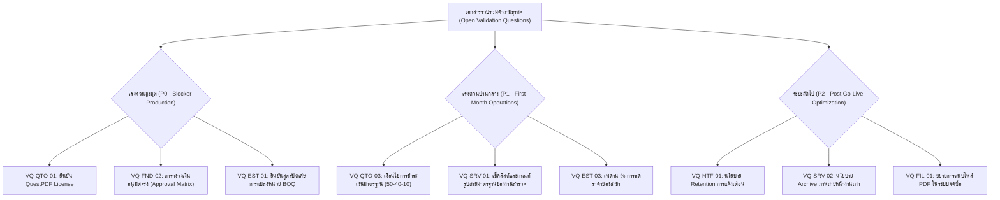

# เอกสารรวบรวมคำถามและสมมติฐานทางธุรกิจ (Open Business Validation Questions)

> **สถานะเอกสาร:** ฉบับร่างสมบูรณ์สำหรับรอการยืนยัน (Pending Stakeholder Sign-Off)  
> **วัตถุประสงค์:** รวบรวมและจัดหมวดหมู่ "สมมติฐานทางธุรกิจชั่วคราว (TEST_ONLY Defaults)" และ "คำถามที่เปิดค้าง (Open Validation Questions)" ของระบบ **tan-erp** ทุกโมดูลไว้ในจุดเดียว เพื่อให้เจ้าของกระบวนการธุรกิจ (Business Owners), ฝ่ายการเงิน (Finance), ทีมกฎหมาย (Legal), และทีมปฏิบัติการ (Operations) ตรวจสอบและอนุมัติเป็นลายลักษณ์อักษรก่อนเปิดใช้งานจริงบน Production

---

## 1. บทนำและแนวทางการให้คำตอบ (Introduction & Guidelines)

ในระหว่างการพัฒนาซอฟต์แวร์ระยะ Application Implementation (Wave A และ Wave B) ทีมพัฒนาได้ยึดหลักการความปลอดภัยสูงสุดแบบ **Fail-Closed** ควบคู่กับการกำหนด **TEST_ONLY Defaults** เพื่อให้ระบบสามารถทดสอบ End-to-End และคงความสมบูรณ์ของข้อมูลได้โดยไม่ต้องเดาข้อมูลทางธุรกิจของลูกค้า

### วิธีการอ่านตารางคำถาม
1. **รหัสคำถาม (Ref ID):** ใช้สำหรับอ้างอิงในการประชุมหรือบันทึกข้อตกลง (ADR)
2. **ประเด็น / ข้อสงสัยทางธุรกิจ:** คำถามที่ต้องการข้อสรุปชัดเจน
3. **สมมติฐานปัจจุบัน (Current Working Assumption / TEST_ONLY):** สิ่งที่ระบบกำลังทำงานอยู่ ณ ปัจจุบัน หากไม่มีการตัดสินใจ ระบบจะยึดพฤติกรรมนี้
4. **ผลกระทบหากไม่สรุป (Impact):** ความเสี่ยงหรือข้อจำกัดต่อการใช้งานจริง
5. **ผู้มีอำนาจตัดสินใจ (Decision Owner):** ผู้มีอำนาจลงนามยืนยัน

---

## 2. หมวดโครงสร้างองค์กร สิทธิ์ และวงเงินอนุมัติ (Foundation, Roles & Approval Limits)

| Ref ID | ประเด็น / ข้อสงสัยทางธุรกิจ | สมมติฐานปัจจุบันในระบบ (TEST_ONLY) | ผลกระทบหากไม่สรุป | ผู้มีอำนาจตัดสินใจ |
| :--- | :--- | :--- | :--- | :--- |
| **VQ-FND-01** | **การรองรับ Multi-Organization ต่อ 1 Deployment:** ในระบบจะมีเพียง 1 องค์กร หรือต้องรองรับหลายนิติบุคคลในฐานข้อมูลเดียวกัน? | มีหลายองค์กรได้ในตาราง แต่ API ปัจจุบันล็อกตาม `OrganizationId` ของผู้เรียก จึงยังไม่มีหน้าจอข้ามองค์กรหรือระบบ Super Admin | หากมีหลายบริษัทในเครือ จะต้องออกแบบสิทธิ์ข้ามองค์กรและระบบ Provisioning เพิ่ม | Business Owner / IT Director |
| **VQ-FND-02** | **ตารางวงเงินอนุมัติตามลำดับขั้น (Approval Limits Matrix):** วงเงินอนุมัติของแต่ละตำแหน่ง (Role) สำหรับ Estimate, PO, Change Order แยกตามสาขาหรือรวมทั้งองค์กร? | **Fail-Closed:** หากไม่มีแถววงเงินในตาราง ระบบจะ **ปฏิเสธการส่งอนุมัติทันที** (ใน Test Env มีเฉพาะบัญชี `Test Admin` ที่ไม่จำกัดวงเงิน) | บน Production ผู้ใช้จะไม่สามารถอนุมัติเอกสารใดๆ ได้เลยจนกว่าจะหยอดตารางวงเงินจริง | Managing Director / CFO |
| **VQ-FND-03** | **เงื่อนไขและนิยามการปิดสาขา (Branch Deactivation):** เงื่อนไขใดที่อนุญาตให้ปิดหรือระงับสาขาได้? | ไม่อนุญาตให้ปิดหากยังมี "เอกสารเปิด" (Estimate ที่ยังไม่ Quoted/Cancelled, PO ค้างรับ, โครงการที่ยังไม่ส่งมอบ ฯลฯ) หรือเป็นสาขาสุดท้าย | อาจบล็อกการปิดสาขาในกรณีต้องการปิดเร่งด่วน หรือเกิดเอกสารค้างในระบบ | Operations / Audit Lead |
| **VQ-FND-04** | **ความเข้มงวดของเลขประจำตัวผู้เสียภาษี (Tax ID):** ต้องบังคับตรวจสอบความถูกต้องแบบ 13 หลัก Mod-11 หรือไม่? | ตรวจสอบรูปแบบ 13 หลักและผ่านสูตร Checksum Mod-11 ของกรมสรรพากรไทย | ลูกค้าชาวต่างชาติหรือองค์กรพิเศษที่ไม่มีเลข 13 หลักจะไม่สามารถบันทึกได้ | Accounting / Tax Lead |

---

## 3. หมวดการสำรวจหน้างาน (Site Survey & Field Mobile)

| Ref ID | ประเด็น / ข้อสงสัยทางธุรกิจ | สมมติฐานปัจจุบันในระบบ (TEST_ONLY) | ผลกระทบหากไม่สรุป | ผู้มีอำนาจตัดสินใจ |
| :--- | :--- | :--- | :--- | :--- |
| **VQ-SRV-01** | **การเลือกเวอร์ชันแม่แบบการสำรวจ (Template Selection):** ช่างหน้างานควรเลือกเวอร์ชันแม่แบบเอง หรือให้ระบบผูกตามประเภทงาน/เวลาเสมอ? | ระบบเลือกแม่แบบเวอร์ชันล่าสุดที่มีผล ณ ปัจจุบัน (`isCurrent`) แบบอัตโนมัติ โดยมีค่ามาตรฐานบังคับภาพถ่ายขั้นต่ำ 1 รูปต่อพื้นที่ และตรวจเช็คลิสต์โครงสร้าง | ช่างไม่สามารถเลือกใช้แม่แบบพิเศษเฉพาะงานได้ เว้นแต่จะระบุใน Template Code ใหม่ | Survey / Service Manager |
| **VQ-SRV-02** | **นโยบายการจัดเก็บและล้างภาพถ่ายหน้างาน (Photo Retention & Purge):** ภาพถ่ายและผลการวัดหน้างานที่ส่งมอบโครงการแล้ว ต้องเก็บไว้นานเท่าใด? | เก็บถาวรใน Storage และบันทึก SHA-256 ลงฐานข้อมูล ไม่มีการลบอัตโนมัติ | ค่าใช้จ่ายพื้นที่จัดเก็บข้อมูล (Cloud Storage) จะเพิ่มขึ้นต่อเนื่องตามจำนวนงาน | Operations / IT Director |
| **VQ-SRV-03** | **การจัดการข้อขัดแย้งขณะทำงานออฟไลน์ (Mobile Offline Conflict Resolution):** หากช่างสองคนบันทึกผลการวัดห้องเดียวกันขณะออฟไลน์ แล้วกลับมาออนไลน์พร้อมกัน จะให้ข้อมูลใดชนะ? | ยึดตามลำดับการส่งเข้า Server ล่าสุด (Last-Write-Wins ต่อ Snapshot Revision) และมี Revision Number ป้องกันการเขียนทับโดยไม่รู้ตัว | ข้อมูลของช่างคนที่ sync ก่อนอาจถูกอัปเดตทับด้วย revision ถัดไป | Lead Engineer / Field Supervisor |

---

## 4. หมวดการประเมินราคา BOQ และ Quick Estimate (Official Estimate & Pricing)

| Ref ID | ประเด็น / ข้อสงสัยทางธุรกิจ | สมมติฐานปัจจุบันในระบบ (TEST_ONLY) | ผลกระทบหากไม่สรุป | ผู้มีอำนาจตัดสินใจ |
| :--- | :--- | :--- | :--- | :--- |
| **VQ-EST-01** | **การเปิดใช้งาน Unit Conversion Snapshot (G-08):** ยืนยันการเปิดใช้ความสามารถแปลงหน่วยในรายการต้นทุน BOQ และเกณฑ์การปัดเศษ? | ต้นทุนรวมแถว = `round(qty × factor × base cost, 2)` ปัดทศนิยม 2 ตำแหน่งครั้งเดียว; ต้นทุนต่อหน่วย = `round(base cost × factor, 4)` | หากฝ่ายบัญชีต้องการสูตรปัดเศษแบบอื่น ตัวเลขต้นทุนสะสมอาจคลาดเคลื่อนระดับสตางค์ | Cost Accounting Owner |
| **VQ-EST-02** | **การอนุญาตให้ใส่รายการพิเศษนอก Item Master (Ad-Hoc / Custom Work Items):** รายการสั่งทำพิเศษที่ไม่มีรหัสใน Catalog ต้องมีเกณฑ์อนุมัติเฉพาะหรือไม่? | บันทึกเป็น Custom Item ได้โดยต้องกรอกเหตุผล (`custom_reason`), บันทึกต้นทุนแยก, และผ่านการอนุมัติแบบ Maker-Checker ปกติ | หากไม่มีข้อจำกัด อาจทำให้เกิดการไม่ควบคุมมาตรฐานรหัสสินค้าและต้นทุน | Purchasing & Cost Control Lead |
| **VQ-EST-03** | **เพดานและสิทธิ์การปรับลดราคาหน้างาน (Quick Estimate Branch Override):** ผู้จัดการสาขาสามารถปรับลด/เพิ่มอัตราคิดราคา (Rate Override) ได้สูงสุดกี่เปอร์เซ็นต์? | สาขาขอ override ได้ โดยต้องให้ผู้ถือสิทธิ์ `pricing-templates.approve` อนุมัติ และมีอายุไม่เกิน 366 วัน (ยังไม่มีเพดาน % สูงสุดล็อกในโค้ด) | อาจเกิดการลดราคามากเกินไปจนกระทบกำไรขั้นต้น (Gross Margin) หากไม่มีเพดานล็อก | Sales Director / CFO |
| **VQ-EST-04** | **รายการกลุ่มงาน (Work Types) สำหรับ Quick Estimate ใน Release แรก:** ปรเภทงานใดบ้างที่จะเปิดให้ประเมินด่วนผ่านหน้าร้าน? | อนุมัติเบื้องต้น 3 กลุ่ม: งานเฟอร์นิเจอร์บิวท์อิน (Built-in), ผ้าม่าน (Curtain), และวอลเปเปอร์ (Wallpaper) | หากมีกลุ่มงานโครงสร้างหรือต่อเติม จะต้องสร้างสูตรคำนวณและ Template ใหม่ | Commercial Director |

---

## 5. หมวดใบเสนอราคา การยอมรับของลูกค้า และลิขสิทธิ์ PDF (Commercial Quotation & Legal)

| Ref ID | ประเด็น / ข้อสงสัยทางธุรกิจ | สมมติฐานปัจจุบันในระบบ (TEST_ONLY) | ผลกระทบหากไม่สรุป | ผู้มีอำนาจตัดสินใจ |
| :--- | :--- | :--- | :--- | :--- |
| **VQ-QTO-01** | **การยืนยันเงื่อนไขลิขสิทธิ์ QuestPDF (QuestPDF License Confirmation):** บริษัทผ่านเกณฑ์รายได้สำหรับ Community License (< $1M USD) หรือต้องจัดซื้อ Commercial License? | ระบบเปิดใช้งานด้วย `LicenseType: Community` และบันทึก Warning ใน Log หากรันบน Production โดยไม่มีการยืนยัน `Documents:QuestPdf:LicenseConfirmed=true` | ความเสี่ยงด้านการละเมิดสิทธิ์ทรัพย์สินทางปัญญาของไลบรารีซอฟต์แวร์ | Legal Counsel / IT Director |
| **VQ-QTO-02** | **ผลผูกพันทางกฎหมายของภาพลายเซ็น (Digital Signature vs Electronic Signature):** การบันทึกภาพลายเซ็นคู่กับ IP, วันเวลา และ SHA-256 ผ่านลิงก์ยอมรับใบเสนอราคา ถือว่ามีผลผูกพันตามกฎหมายเพียงพอหรือไม่? | เก็บภาพลายเซ็น (PNG) + วันเวลาเซิร์ฟเวอร์ + SHA-256 + Audit Log แต่ **ไม่ใช่ e-Signature ขั้นสูง (Advanced/Qualified) ที่มี Certificate PKI** | ในกรณีมีข้อพิพาททางคดีความ อาจต้องใช้พยานหลักฐานอื่นประกอบสัญญาจ้าง | Legal / Corporate Compliance |
| **VQ-QTO-03** | **เงื่อนไขการชำระเงินและข้อความท้ายใบเสนอราคา (Commercial Terms & Payment Terms):** งวดการชำระเงินและเงื่อนไขการยืนราคามาตรฐานขององค์กร? | งวดเงิน 3 งวด: มัดจำ 50%, ส่งวัสดุเข้าหน้างาน 40%, ส่งมอบงาน 10%; ยืนราคาภายใน 30 วันนับจากวันที่ออกเอกสาร | หากเงื่อนไขจริงของบริษัทต่างจากนี้ ต้องแจ้งเพื่อปรับ Document Template มาตรฐาน | Finance Director / Sales Lead |
| **VQ-QTO-04** | **นโยบายต่อใบเสนอราคาที่ออกก่อนติดตั้งระบบ PDF (Legacy Quotations):** เอกสารใบเสนอราคาเดิมที่ไม่มีไฟล์ PDF ในระบบ จะใช้วิธีใดเมื่อลูกค้าขอไฟล์? | ระบบ **ไม่ออก PDF ย้อนหลังให้เอกสารเก่า** โดยอัตโนมัติ (คืน 404 หากดาวน์โหลด); ผู้ใช้ต้องกด "Amend (ออกฉบับใหม่)" หรือใช้ Browser Print เดิม | พนักงานขายอาจสับสนหากพยายามดาวน์โหลดไฟล์ของเอกสารฉบับเก่า | Sales Admin / Operations |

---

## 6. หมวดระบบแจ้งเตือนและประวัติการตรวจสอบ (Notifications & Auditing)

| Ref ID | ประเด็น / ข้อสงสัยทางธุรกิจ | สมมติฐานปัจจุบันในระบบ (TEST_ONLY) | ผลกระทบหากไม่สรุป | ผู้มีอำนาจตัดสินใจ |
| :--- | :--- | :--- | :--- | :--- |
| **VQ-NTF-01** | **อายุการจัดเก็บรายการแจ้งเตือน (Notification Retention Period):** การแจ้งเตือนในกระดิ่งแจ้งเตือนที่ผู้ใช้อ่านแล้ว ควรเก็บไว้กี่วันก่อนลบออกจากระบบ? | ปัจจุบัน **ไม่มีการลบข้อมูลออกจากตาราง** (No Purge / Retention Policy) ข้อมูลจะสะสมไปเรื่อยๆ | ตารางการแจ้งเตือนอาจมีขนาดใหญ่ขึ้นมากในระยะยาว ส่งผลต่อประสิทธิภาพการสืบค้น | IT Operations / DBA |
| **VQ-NTF-02** | **ลำดับการแจ้งเตือนการอนุมัติแบบหลายขั้น (Multi-level Approval Routing):** เมื่อผู้ตรวจขั้นที่ 1 อนุมัติแล้ว ควรแจ้งเตือนไปยังผู้ตรวจขั้นที่ 2 อัตโนมัติทันทีหรือไม่? | แจ้งเตือนเฉพาะผู้มีสิทธิ์ขั้นแรกของ Route; การแจ้งเตือนขั้นถัดไปยังพึ่งพาการเปิดดู Review Queue | ผู้ตรวจขั้นสูงอาจไม่ทราบว่ามีเอกสารรอการอนุมัติต่อจากขั้นแรก | Business Process Owner |

---

## 7. หมวดไฟล์แนบและภาพถ่ายร่วม (Shared File Attachments)

| Ref ID | ประเด็น / ข้อสงสัยทางธุรกิจ | สมมติฐานปัจจุบันในระบบ (TEST_ONLY) | ผลกระทบหากไม่สรุป | ผู้มีอำนาจตัดสินใจ |
| :--- | :--- | :--- | :--- | :--- |
| **VQ-FIL-01** | **ขอบเขตประเภทไฟล์แนบของระบบกลาง (Allowed File Types):** อนุญาตเฉพาะไฟล์รูปภาพ (JPEG, PNG, WEBP) หรือรวมถึงไฟล์เอกสาร (PDF, CAD, ZIP)? | ปัจจุบันระบบกลางรองรับเฉพาะรูปภาพ (สำหรับหน้างาน, สินค้า, ลายเซ็น); โมดูล Procurement ที่ต้องการแนบใบเสนอราคาคู่แข่งเป็น PDF ยังรอเปิดขอบเขต | ไม่สามารถแนบไฟล์สเปกเครื่องจักรหรือเอกสารสัญญาเพิ่มเติมในรูปแบบ PDF ได้ | Operations / IT Director |
| **VQ-FIL-02** | **ขนาดไฟล์สูงสุดต่อการอัปโหลด (Max Upload Size):** กำหนดขนาดไฟล์รูปภาพสูงสุดกี่ Megabytes ต่อรูป? | จำกัดขนาดที่ 15 MB ต่อไฟล์รูปภาพ และทำการตรวจสอบ Magic Bytes ที่เซิร์ฟเวอร์ | หากขนาดใหญ่เกินไปอาจเปลืองแบนด์วิดท์มือถือหน้างาน; หากเล็กไปรูปอาจขาดความคมชัด | IT Infrastructure / Mobile Lead |

---

## 8. ตารางสรุปลำดับความสำคัญและการดำเนินการ (Action Plan & Priority Matrix)

---

## 9. ส่วนการลงนามและยืนยัน (Stakeholder Sign-Off)

| ตำแหน่ง / บทบาท | ชื่อ-นามสกุล | ความเห็นชอบ / ข้อสั่งการ | วันที่ลงนาม |
| :--- | :--- | :--- | :--- |
| **กรรมการผู้จัดการ (Managing Director)** | ___________________________ | [ ] อนุมัติตามสมมติฐาน [ ] มีข้อแก้ไขเพิ่มเติม | _____/_____/_________ |
| **ผู้อำนวยการฝ่ายการเงิน (CFO / Finance Director)** | ___________________________ | [ ] อนุมัติตามสมมติฐาน [ ] มีข้อแก้ไขเพิ่มเติม | _____/_____/_________ |
| **ผู้อำนวยการฝ่ายปฏิบัติการ (Operations Director)** | ___________________________ | [ ] อนุมัติตามสมมติฐาน [ ] มีข้อแก้ไขเพิ่มเติม | _____/_____/_________ |
| **ที่ปรึกษากฎหมาย (Legal Counsel)** | ___________________________ | [ ] อนุมัติตามสมมติฐาน [ ] มีข้อแก้ไขเพิ่มเติม | _____/_____/_________ |
